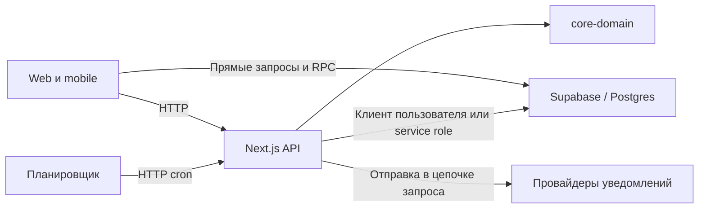

# Архитектура Kezek

Статус: описание по исходникам, сверено 30 октября 2026. Сопровождение: команда разработки; персональный ответственный не назначен. Фактическое развёртывание и права удалённой базы описанием исходников не устанавливаются.

## Состав системы

| Часть | Реализация | Ответственность |
| --- | --- | --- |
| Web и HTTP API | [apps/web](apps/web/README.md), Next.js 16 / React 19 | Страницы, кабинеты, API, webhooks, cron handlers |
| Mobile | [apps/mobile](apps/mobile/README.md), Expo 54 / React Native 0.81 | Экраны, навигация, сессии, HTTP и прямые обращения к Supabase |
| Общая доменная логика | [core-domain](packages/core-domain/README.md) | Booking use cases, переходы статусов, расчёты финансов, schedule helpers и порты |
| Общие клиентские модули | [shared-client](packages/shared-client/README.md) | DTO, валидация, форматирование, логирование и HTTP-клиент |
| Данные и авторизация | [Supabase](supabase/README.md) | Postgres, RPC, триггеры, RLS, Auth, Storage |
| Интеграции | Сервисы в `apps/web/src/lib` | Resend, Telegram, WhatsApp, OAuth; конфигурация зависит от окружения |

Точные версии и команды задают [web package.json](apps/web/package.json), [mobile package.json](apps/mobile/package.json), [корневой package.json](package.json) и lockfile.

## Роли и кабинеты

| Поверхность | Назначение |
| --- | --- |
| `/b/[slug]`, каталог, карта | Публичная информация и запись |
| `/cabinet` | Клиентские записи и профиль |
| `/dashboard` | Работа с выбранным бизнесом для разрешённых управленческих ролей |
| `/staff` | Работа сотрудника, записи и смены |
| `/admin` | Администрирование платформы |

Навигация и видимость кнопки не являются проверкой доступа к данным. Пользователь может иметь несколько ролей и бизнесов; выбранный контекст должен проверяться на каждой доверенной границе.

## Фактические пути данных

Схема показывает пути вызовов по исходникам. Доступность и число серверов конкретного окружения здесь не установлены. Внутри PostgreSQL также выполняются бизнес-правила и триггеры.

1. **Web/mobile → Next.js API → Supabase.** Маршрут обычно делегирует HTTP-сервису, далее сервисам и адаптерам. Часть операций использует пользовательский клиент с RLS, часть — service role.
2. **Web/mobile → Supabase напрямую.** Например, загрузка слотов вызывает RPC из [web-хука](apps/web/src/app/b/[slug]/hooks/useSlotsLoader.ts) и [mobile-хука](apps/mobile/src/screens/booking/useBookingStep5Slots.ts). Проверка только в Next.js не защищает этот путь.
3. **Postgres → функции и триггеры.** Здесь находятся проверки расписаний, изменения статусов, списания пакетов и финансовые операции. TypeScript domain package не является единственным местом бизнес-правил.
4. **Scheduler → HTTP cron → Supabase/провайдеры.** Наличие route не означает, что задача реально запланирована. Источник расписаний и расхождения двух manifests: [эксплуатация](docs/OPERATIONS.md).
5. **Booking → уведомления.** Текущий [use case](packages/core-domain/src/booking/useCases.ts) ожидает отправку после подтверждения. В этой цепочке durable outbox не реализован; его внедрение остаётся предложением из реестра.

## Границы доверия

- Публичные URL и anon-ключ Supabase доступны клиенту. Секрет service role остаётся серверным и обходит RLS.
- [Middleware](apps/web/src/middleware.ts) не является общей защитой API: пути `/api` пропускаются. Авторизация зависит от конкретного handler/service и SQL-границы.
- [authBiz](apps/web/src/lib/authBiz.ts), [requestAuthContext](apps/web/src/lib/requestAuthContext.ts) и обёртки контекста разрешают пользователя, роль и бизнес для части операций. Нельзя предполагать, что все маршруты применяют одинаковые проверки.
- `SECURITY DEFINER` выполняется с правами владельца функции. Доступность RPC, проверка actor/tenant и права таблиц должны оцениваться вместе.
- Service role требует явной проверки каждого объекта, включая вложенные ID в запросе. Проверка сотрудника не доказывает принадлежность переданных броней.

Открытые нарушения и условия их воспроизведения: [инженерный реестр](docs/ENGINEERING_FINDINGS.md). Эта карта не является сертификацией ACL/RLS.

## Согласованность и состояние

Сохранение позиций смены в [staffShiftItemsService](apps/web/src/lib/staffShiftItemsService.ts) выполняет несколько независимых запросов. Наличие отдельной SQL-функции с именем `atomic` не означает, что текущая цепочка её вызывает или что вся операция атомарна.

Блокировка сотрудника в [booking trigger](supabase/migrations/20260918130000_explicit_staff_schedules.sql) сериализует часть записей. Повторная проверка пересечений условна для новой модели расписаний; ограничения исходной схемы legacy staff требуют отдельной сверки.

React Query хранит данные в клиенте. Кроме этого, в web есть process-local `Map` для обмена мобильной сессией, кэша и ряда защит. Общий Redis используется лимитером при доступной конфигурации с локальным fallback. При нескольких инстансах такое состояние не становится автоматически общим.

## База и развёртывание

Миграции лежат в `supabase/migrations`, но репозиторий не содержит подтверждённого полного bootstrap основных таблиц с пустой базы. Порядок подготовки среды: [GETTING_STARTED.md](GETTING_STARTED.md), применение и сверка: [APPLY_MIGRATIONS.md](supabase/APPLY_MIGRATIONS.md).

В репозитории есть два Vercel cron manifests. Реальный deployment root, ресурсы, применённая схема, RPO/RTO и предел нагрузки не устанавливаются их наличием. Эти сведения и требования к их подтверждению собраны в [OPERATIONS.md](docs/OPERATIONS.md).

## Правила развития

[MODULE_BOUNDARIES.md](docs/MODULE_BOUNDARIES.md) задаёт желаемое размещение новой логики: чистые правила в domain, транспорт и persistence в приложении. Это правило разработки, а не утверждение, что перенос всех существующих правил завершён.

Для нового HTTP endpoint: [шаблон маршрута](apps/web/src/lib/HOWTO_NEW_API_ENDPOINT.md). Для проверки изменения: [TESTING_GUIDE.md](TESTING_GUIDE.md). Приоритет работы задают [текущее состояние](docs/PROJECT_STATUS.md) и новая задача человека, а не старые roadmap.
